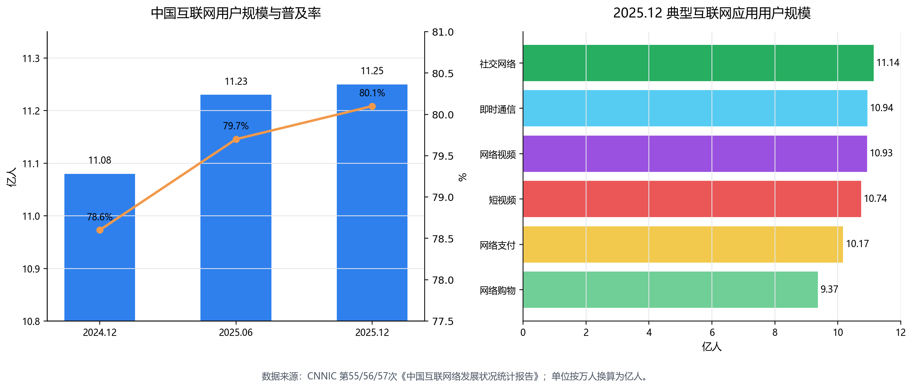
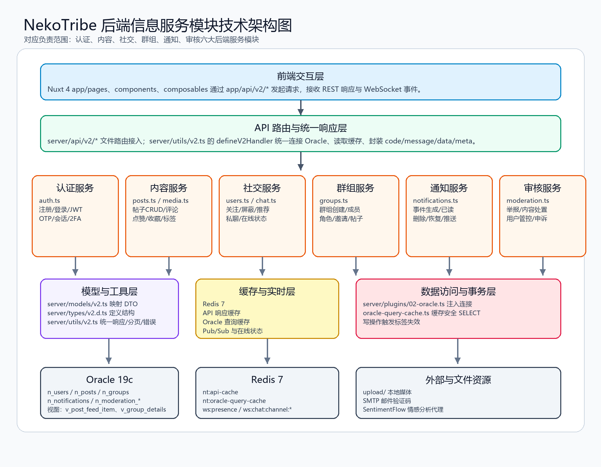

# NekoTribe 后端信息服务模块研究说明

负责范围：图片中的六大信息服务模块，重点对应本项目后端实现。  
项目位置：`C:\Code\NekoTribe`  
技术栈：Nuxt 4 / Nitro Server API / TypeScript / Oracle 19c / Redis 7 / WebSocket / Docker Compose。

## 一．项目背景及意义（800以内）

随着移动互联网进入高普及阶段，社交、内容发布和即时通信已经成为数字生活的基础设施。CNNIC 第57次报告显示，截至2025年12月，我国网民规模达11.25亿，互联网普及率80.1%；第56次报告也显示，2025年6月社交网络、即时通信、网络视频等应用均保持十亿级用户规模。这说明社交类系统不再只是“发帖页面”，而是身份认证、内容生产、关系连接、群体协作、实时通知和内容治理共同组成的信息服务平台。

NekoTribe 的意义在于用完整工程链路复现一个现代社交平台后端：它通过 `server/api/v2/**` 提供资源化 API，通过 `server/services/v2/**` 承载业务逻辑，通过 Oracle 保存用户、帖子、关系、群组、通知和审核数据，通过 Redis 处理缓存、在线状态和实时广播。项目不仅能支撑用户注册登录、发帖评论、关注屏蔽、群组互动等基础需求，还能通过通知和审核模块形成“信息发布-传播-反馈-治理”的闭环。对课程/答辩而言，该项目能体现数据库设计、接口规范、安全认证、缓存优化、实时通信和内容治理等后端综合能力，具有较强的实践和展示价值。

{ width=6.3in }

表1 数据图源表（可直接在 Word 中按“组合柱形图+折线图”和“横向条形图”复现）

| 指标 | 2024.12 | 2025.06 | 2025.12 | 建议图形 |
| --- | ---: | ---: | ---: | --- |
| 网民规模（亿人） | 11.08 | 11.23 | 11.25 | 柱形图 |
| 互联网普及率（%） | 78.6 | 79.7 | 80.1 | 折线图 |
| 社交网络用户规模（亿人） | 11.01 | 11.07 | 11.14 | 横向条形图 |
| 即时通信用户规模（亿人） | 10.81 | 10.93 | 10.94 | 横向条形图 |
| 网络视频用户规模（亿人） | 10.70 | 10.85 | 10.93 | 横向条形图 |
| 短视频用户规模（亿人） | 10.40 | 10.68 | 10.74 | 横向条形图 |

## 二．研究现状（600以内）

目前社交平台后端研究与工程实践主要集中在四个方向。第一，接口从功能型接口转向资源化 API，强调统一响应、分页、鉴权和错误码；本项目在 `server/utils/v2.ts` 中用 `defineV2Handler`、`v2Ok`、`v2Throw` 统一处理。第二，数据层从单表 CRUD 转向关系图谱和内容生命周期管理，用户、帖子、评论、关注、群组、通知、审核之间需要通过视图、索引和事务保持一致；本项目集中体现在 `doc/neko_tribe-oracle-v2.sql`。第三，实时体验成为标配，WebSocket 与 Redis Pub/Sub 被用于通知、在线状态和聊天广播；对应实现是 `server/routes/_ws.ts`、`server/services/v2/chat.ts`、`presence.ts`。第四，内容安全和智能治理重要性提升，举报、审核、用户处罚、申诉和情感分析逐渐成为社交系统后端的必备能力；本项目由 `server/services/v2/moderation.ts` 和 SentimentFlow 集成承担。

## 三．项目流程与技术路线（1500字以内）

项目流程从“用户请求”进入：前端页面和组件通过 `app/api/v2/*` 或 `$fetch` 调用后端；Nitro 文件路由 `server/api/v2/*` 只负责接收参数、绑定路径变量并调用服务层；公共入口 `defineV2Handler` 自动记录日志、读取 Redis API 缓存、获取 Oracle 连接、返回统一 `V2Response`。服务层按图片中的六大模块拆分：认证服务处理注册、登录、OTP、JWT、刷新令牌、会话和二次验证；内容服务处理帖子、评论、点赞、收藏、标签、媒体和热度；社交服务处理用户资料、关注、屏蔽、静音、推荐、私聊和在线状态；群组服务处理群组 CRUD、成员角色、邀请、群组帖子和审计日志；通知服务处理通知生成、列表、已读、删除、恢复和实时推送；审核服务处理举报、内容处置、用户封禁/禁言、申诉和审核配置。

技术路线采用“模块化单体 + 清晰分层”的方式，而不是把课程项目拆成过重的微服务。API 层保持轻量，业务规则放在 `server/services/v2/*.ts`；数据映射放在 `server/models/v2.ts`；统一类型放在 `server/types/v2.d.ts` 和 `app/types/v2.ts`；数据库对象由 `doc/neko_tribe-oracle-v2.sql` 提供。Oracle 负责持久化和事务一致性，核心表包括 `n_users`、`n_auth_sessions`、`n_posts`、`n_comments`、`n_groups`、`n_notifications`、`n_moderation_reports`、`n_moderation_cases`、`n_chat_messages` 等；视图如 `v_user_profile_public`、`v_post_feed_item`、`v_group_details`、`v_notification_list_item` 用于聚合展示数据。Redis 负责两类性能优化：`server/utils/api-cache.ts` 缓存 v2 GET 响应，`server/utils/oracle-query-cache.ts` 在 Oracle 连接层拦截安全 `SELECT/WITH` 查询并缓存，写操作后通过标签版本失效避免旧数据继续被读取。

实时路线由 `server/routes/_ws.ts` 维护 WebSocket 会话、房间、心跳和频道订阅，`server/services/v2/chat.ts` 在消息创建、编辑、删除、表情反应时发布 `chat_message` 等事件，`server/services/v2/notifications.ts` 在点赞、评论、关注、群组邀请等事件后写入 `n_notifications` 并通过 Redis 频道推送，`server/services/v2/presence.ts` 则根据会话活跃时间和 WebSocket 连接发布在线状态。部署路线由 `docker-compose.yml` 组织 app、Oracle、Redis、Nginx 和数据库初始化脚本，保证项目可从本地开发过渡到容器化运行。

{ width=6.3in }

表2 六大模块与具体代码实现对应表

| 模块 | 主要接口入口 | 核心服务实现 | 数据库/支撑对象 |
| --- | --- | --- | --- |
| 认证服务 | `server/api/v2/auth/**` | `server/services/v2/auth.ts`：`v2Register`、`v2Login`、`v2RefreshCurrentToken`、`v2ListSessions`、二次验证相关函数 | `n_users`、`n_auth_sessions`、`n_auth_otp_events`、`n_user_two_factor_*` |
| 内容服务 | `server/api/v2/posts/**`、`comments/**`、`media/**` | `server/services/v2/posts.ts`：`v2ListPosts`、`v2CreatePost`、`v2UpdatePost`、`v2CreateComment`、`v2LikePost`；`media.ts` 处理上传 | `n_posts`、`n_comments`、`n_post_likes`、`n_post_bookmarks`、`n_tags`、`n_media_assets` |
| 社交服务 | `server/api/v2/users/**`、`chat/**` | `server/services/v2/users.ts`：关注、屏蔽、静音、推荐；`chat.ts`：群聊/私聊；`presence.ts`：在线状态 | `n_user_follows`、`n_user_blocks`、`n_user_mutes`、`n_chat_*`、`n_direct_*` |
| 群组服务 | `server/api/v2/groups/**`、`users/me/groups` | `server/services/v2/groups.ts`：`v2CreateGroup`、`v2JoinGroup`、`v2ChangeMemberRole`、`v2CreateGroupPost`、`v2CreateGroupInvite` | `n_groups`、`n_group_members`、`n_group_posts`、`n_group_invites`、`v_group_details` |
| 通知服务 | `server/api/v2/notifications/**` | `server/services/v2/notifications.ts`：`v2CreateNotification`、`v2ListNotifications`、`v2SetNotificationReadStatus`、`v2RestoreNotification` | `n_notifications`、Redis 用户通知频道、`v_notification_list_item` |
| 审核服务 | `server/api/v2/moderation/**`、`reports/**` | `server/services/v2/moderation.ts`：`v2CreateReport`、`v2ListModerationContent`、`v2ModeratePost`、`v2ModerateUser`、`v2PatchModerationAppeal` | `n_moderation_reports`、`n_moderation_cases`、`n_moderation_actions`、`n_moderation_user_restrictions` |

## 四．总结（200字以内）

NekoTribe 后端围绕“身份可信、内容可管、关系可查、群组可协作、消息可触达、风险可治理”展开。项目以 Nuxt Nitro 承载 API，以服务层隔离业务，以 Oracle 保证数据一致性，以 Redis 提升查询和实时能力。六大模块与代码结构对应清晰，既能说明社交系统的信息服务流程，也能展示数据库、缓存、鉴权、实时通信和内容审核的综合后端实现。

## 参考资料

[1] CNNIC：《第57次中国互联网络发展状况统计报告》，2026-02-05，https://cnnic.cn/n4/2026/0304/c88-11549.html  
[2] CNNIC：《第56次中国互联网络发展状况统计报告》，2025-07-21，https://www.cnnic.cn/n4/2025/0721/c88-11328.html  
[3] CNNIC：《第55次中国互联网络发展状况统计报告》，2025-01-17，https://www.cnnic.cn/n4/2025/0117/c88-11229.html  
[4] 项目源码：`C:\Code\NekoTribe`，重点文件见表2。
